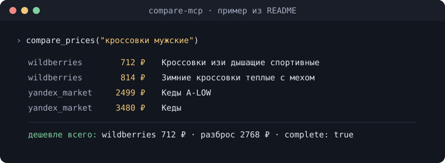

# ru-marketplace-mcp

**Русский** · [English](README.en.md)

[](https://github.com/Vladimir-Human/ru-marketplace-mcp/actions/workflows/ci.yml)
[](https://pypi.org/project/ru-marketplace-mcp/)
[](https://www.python.org/downloads/)
[](LICENSE)
[](https://modelcontextprotocol.io)
[](https://glama.ai/mcp/servers/Vladimir-Human/ru-marketplace-mcp)
[](https://www.npmjs.com/package/ru-marketplace-mcp-dsh)

**MCP-серверы для российских и китайских маркетплейсов.** Цены, наличие,
рейтинги, отзывы и реквизиты продавцов с Wildberries, Ozon, Яндекс Маркета,
Детского мира, Авито, AliExpress, Taobao, Мегамаркета, Lamoda, DNS и Ситилинка.
Плюс недвижимость с Циана и
сравнение цен по всем товарным источникам одним вызовом.

Только чтение. Ключи API, токены и регистрация не нужны — площадки с жёстким
анти-ботом читаются через ваш собственный Chrome. Одно исключение по желанию:
опциональный MPStats берёт платный токен (`MPSTATS_MP_AUTH`) — без него всё
остальное работает как прежде.

<p align="center">
  
</p>

<sub>Пример вызова из раздела [«Сравнение цен»](#сравнение-цен--compare_).</sub>

## Быстрый старт

Нужны **Python 3.12+** и [uv](https://docs.astral.sh/uv/).

Без checkout пакет ставится с PyPI и сам подключается к найденному клиенту
(`--dry-run` покажет план и ничего не запишет):

```bash
uvx ru-marketplace-mcp setup
```

Или в один клик: [](https://vscode.dev/redirect/mcp/install?name=marketplace&config=%7B%22command%22%3A%22uvx%22%2C%22args%22%3A%5B%22--from%22%2C%22ru-marketplace-mcp%22%2C%22compare-mcp%22%5D%7D) [](https://cursor.com/en/install-mcp?name=marketplace&config=eyJjb21tYW5kIjoidXZ4IiwiYXJncyI6WyItLWZyb20iLCJydS1tYXJrZXRwbGFjZS1tY3AiLCJjb21wYXJlLW1jcCJdfQ==)

Для установки клиента, выбора источников и проверки первого предложения —
[пошаговый старт](docs/QUICKSTART.md). Node нужен только для тестов разработчика.
Публикация на PyPI (для владельца): [DEPLOYMENT.md — PyPI](docs/DEPLOYMENT.md#pypi-maintainer).

Из исходников, для разработки:

```bash
git clone https://github.com/Vladimir-Human/ru-marketplace-mcp.git
cd ru-marketplace-mcp
uv sync --all-packages
uv run pytest -q -m "not live and not cdp"   # 3442 офлайн-тестов, сеть не нужна
```

Проверка живого эндпоинта:

```bash
uv run python -c "
import asyncio
from wb_connector.server import wb_selfcheck
print(asyncio.run(wb_selfcheck()).status)   # ждём success
"
```

[Первый успешный запрос](docs/QUICKSTART.md) · [Архитектура](docs/ARCHITECTURE.md) ·
[Как добавить источник](docs/ADDING_A_SOURCE.md) · [Про анти-бот](docs/ANTI_BOT.md)

---

## Что внутри

| Сервер            | Инструментов | Что нужно, чтобы читалось                                                  | Что умеет                                                                                 |
| ----------------- | ------------ | -------------------------------------------------------------------------- | ----------------------------------------------------------------------------------------- |
| **Wildberries**   | 8            | анонимный HTTP                                                             | Поиск, карточки, отзывы, вопросы о товаре, реквизиты продавца, каталог и товары категории |
| **Яндекс Маркет** | 2            | анонимный HTTP                                                             | Цены разных продавцов, разбивка оценок по звёздам, отзывы                                 |
| **Детский мир**   | 3            | анонимный HTTP                                                             | Детские товары, наличие в офлайн-магазинах, категории                                     |
| **Ozon**          | 3            | ваш Chrome; с домашнего IP часто и без него                                | Поиск, карточки, отзывы                                                                   |
| **Авито**         | 3            | ваш Chrome + российский домашний IP и запросы вразрядку — иначе блок по IP | Поиск объявлений, карточки, репутация продавца                                            |
| **Taobao**        | 2            | ваш Chrome с активным входом в Taobao                                      | Поиск и карточки, цены в юанях                                                            |
| **Мегамаркет**    | 2            | ваш Chrome с активным входом — анонимной сессии API отдаёт пусто           | Поиск и карточки через мобильный API                                                      |
| **Lamoda**        | 2            | карточки: HTTP GraphQL → Chrome при отказе; поиск — Chrome                            | Поиск, карточки с размерами                                                               |
| **DNS**           | 2            | ваш Chrome (Qrator)                                                        | Поиск и карточки электроники                                                              |
| **Ситилинк**      | 2            | ваш Chrome (Qrator)                                                        | Поиск и карточки электроники                                                              |
| **AliExpress**    | 2            | ваш Chrome (x5sec)                                                       | Поиск и карточки, цены в рублях                            |
| **Циан**          | 2            | ваш Chrome (WAF по IP)                                                     | Недвижимость: поиск по фильтрам (продажа, аренда, посуточно) и карточка объявления         |
| **Сравнение**     | 4            | опрашивает всё перечисленное                                               | «Где дешевле?» одним вызовом                                                              |
| **MPStats**       | 2            | платный аккаунт MPStats, cookie `mp_auth` (опционально)                    | Продажи/остатки/графики за 30 дней по SKU Ozon/WB, остатки по складам (FBS/FBO)           |

Читается анонимно, без браузера: Wildberries, Яндекс Маркет и Детский мир.
Карточки Lamoda сначала читаются по HTTP GraphQL; при отказе нужен ваш Chrome
(CDP) для запасного уровня. Остальным нужен ваш залогиненный Chrome (CDP). Taobao и
Мегамаркет вдобавок требуют активного входа в саму площадку — без него Taobao
упирается в стену логина, а Мегамаркет отдаёт пустой ответ. Авито ещё и блокирует
по IP: с датацентрового адреса это глухой отказ, с российского домашнего — работает,
если не частить запросами. Запросы к CDP-источникам идут вразрядку: очередь
подряд без пауз роняет их (DNS и Taobao в проверке так и деградировали), поэтому
коннекторы держат паузу между вызовами сами. Точное состояние из вашей сессии
покажет `marketplace-mcp doctor`.

MPStats стоит особняком: это единственный **платный** источник. Без
`MPSTATS_MP_AUTH` объединённый `marketplace-mcp` вообще не монтирует его
инструменты — они всё равно отвечали бы `auth_missing` — поэтому он опционален
и подключается по желанию, на остальные тринадцать серверов он не влияет никак.
Отдельный `mpstats-mcp` запускается и без токена и на вызовы отвечает
`auth_missing`.

Всего 39 инструментов в 14 серверах на общем рантайме `mcp-core`. Плюс объединённый
`marketplace-mcp`, который монтирует всё разом — одна запись в конфиге клиента
вместо четырнадцати. У него два своих инструмента: `marketplace_sources` (какие
коннекторы поднялись, а какие отвалились и почему) и `marketplace_health` (жив ли
Chrome, какие хосты остывают, какую страницу открыть человеку). С токеном MPStats
в нём 41 инструмент, без токена — 39: те же смонтированные источники минус два
`mpstats_*`, плюс эти два.

**Проверка 2.7.0:** 30 октября с одного адреса Wildberries при отказе API (HTTP 403) сам прочитал поиск через Chrome: 40 товаров, у всех цена. Код остальных источников с v2.6.0 не менялся; их проверял [прогон v2.6.0](docs/releases/RELEASE_NOTES_v2.6.0.md#статус-живой-проверки) того же дня (12 из 13 источников, MPStats без токена). [Подробности v2.7.0](docs/releases/RELEASE_NOTES_v2.7.0.md#статус-живой-проверки).

## Подключение к MCP-клиенту

Каждый сервер — консольная команда, поэтому пути в конфиге не зашиваются.

<details open>
<summary><b>Claude Desktop</b> — <code>claude_desktop_config.json</code></summary>

Windows: `%APPDATA%\Claude\claude_desktop_config.json`
macOS: `~/Library/Application Support/Claude/claude_desktop_config.json`

Самый короткий путь — `marketplace-mcp setup`: команда находит Claude Desktop,
Cursor и Claude Code, пишет им конфиг (по умолчанию профиль `compare`),
запускает scraping-Chrome, прогоняет `doctor` и предлагает `unblock` для
источника, закрытого браузером. `--dry-run` только печатает шаги и файлы.

```console
marketplace-mcp setup
```

Если клиент нетипичный или нужен один конкретный, тот же конфиг пишет
`install --write`:

```console
marketplace-mcp install claude --write
```

Команда допишет запись `marketplace` в конфиг Claude Desktop
(`%APPDATA%\Claude\claude_desktop_config.json` на Windows,
`~/Library/Application Support/Claude/claude_desktop_config.json` на macOS,
`~/.config/Claude/claude_desktop_config.json` на Linux). Путь к `uv` и к вашему
checkout подставятся абсолютными (у десктопного клиента часто нет PATH
терминала), чужие серверы и остальные настройки конфига останутся на месте,
старый файл сохранится как `claude_desktop_config.json.bak-<метка>`. Остаётся
перезапустить клиент. `--dry-run` показывает, что именно будет записано, и
ничего не пишет; `--per-source` возвращает старую раскладку — по записи на
источник — и с `--profile` не сочетается.

По умолчанию запись запускает `compare-mcp` — профиль `compare`: 4 инструмента
сравнения цен, самый дешёвый в каждом запросе. `--profile decision` добавляет
осмотр карточки из шортлиста (5 инструментов), `--profile full` берёт
`marketplace-mcp` со всеми инструментами источников — в несколько раз дороже
(замер по профилям — в [docs/TOOLS.md](docs/TOOLS.md)).
Меняется только консольная команда записи, имя `marketplace` остаётся прежним.
Подробнее о выборе режима — [dsh/README.md](dsh/README.md) и
`docs/QUICKSTART.md`.

Если конфиг удобнее править руками, начните с одной записи:

```jsonc
{
  "mcpServers": {
    "marketplace": {
      "command": "uv",
      "args": ["run", "--directory", "C:/путь/к/ru-marketplace-mcp", "compare-mcp"],
    },
  },
}
```

Если нужны отдельные серверы, `marketplace-mcp install claude --per-source`
напечатает готовый блок для вставки. Путь к вашему checkout там уже подставлен:
заглушку `/path/to/ru-marketplace-mcp` править руками не придётся. При установке из
wheel вместо путей печатаются консольные команды на PATH. Неизвестное имя клиента
(допустимы `claude`, `claude-code`, `cursor`, `dsh`) команда отклоняет с пояснением и
кодом возврата 2 — молча подставить блок для Claude она не может.

У браузерного уровня есть ещё команды: `marketplace-mcp browser start`
(запустить scraping-Chrome; по умолчанию окно видно, `--hidden` — за экраном),
`marketplace-mcp browser status` (достижим ли CDP-эндпоинт, какая версия Chrome,
сколько вкладок и где окно) и `marketplace-mcp browser show` (окно
scraping-Chrome на экран — на Windows автозапуск коннектора стартует за экраном,
и без этого нельзя ни войти руками, ни пройти проверку сайта). Когда `doctor`
показывает стену, `marketplace-mcp unblock <source>` откроет нужную страницу в
новой вкладке, подождёт, пока вы пройдёте проверку или войдёте, и перепроверит
только этот источник. Ни одна из этих команд не ходит в сайты сама и не решает
проверку за человека.

Минимальный
вариант вручную:

```jsonc
{
  "mcpServers": {
    "wildberries": {
      "command": "uv",
      "args": ["run", "--directory", "C:/путь/к/ru-marketplace-mcp", "wb-mcp"],
    },
    "ozon": {
      "command": "uv",
      "args": ["run", "--directory", "C:/путь/к/ru-marketplace-mcp", "ozon-mcp"],
    },
    "compare-prices": {
      "command": "uv",
      "args": ["run", "--directory", "C:/путь/к/ru-marketplace-mcp", "compare-mcp"],
    },
  },
}
```

Путь пишите с прямыми слешами `/` или двойными обратными `\\`. Полный список
команд — `wb-mcp`, `ozon-mcp`, `yandex-mcp`, `detmir-mcp`, `avito-mcp`,
`taobao-mcp`, `megamarket-mcp`, `lamoda-mcp`, `dns-mcp`, `citilink-mcp`,
`compare-mcp`, `marketplace-mcp`.

### Только нужные площадки: `MARKETPLACE_SOURCES`

Объединённый сервер монтирует все источники, а описания их инструментов уходят
в контекст **в каждом запросе**. Переменная `MARKETPLACE_SOURCES` оставляет
только перечисленные:

```jsonc
{
  "mcpServers": {
    "marketplace": {
      "command": "uv",
      "args": ["run", "--directory", "C:/путь/к/ru-marketplace-mcp", "marketplace-mcp"],
      "env": {
        "MARKETPLACE_SOURCES": "wildberries,ozon,yandex_market,avito,aliexpress,dns,compare",
      },
    },
  },
}
```

Имена — канонические (`wildberries`, `ozon`, `yandex_market`, `detsky_mir`,
`avito`, `taobao`, `megamarket`, `lamoda`, `dns`, `citilink`, `aliexpress`,
`cian`, `compare`, `mpstats`); короткие псевдонимы `wb`, `ym`/`yandex`, `detmir`, `ali`
тоже принимаются. Неизвестное имя отклоняется при запуске с перечнем
поддерживаемых источников, чтобы опечатка не превратилась в частичный сервер.
Переменная не задана или пуста — монтируется всё, как раньше.
Отключённые источники видно в `marketplace_sources`: они попадают в `skipped`
с пометкой, что их сняли, а не что они не импортировались. `compare_prices`
опрашивает ровно тот же набор.

</details>

<details>
<summary><b>Claude Code</b></summary>

Установка плагина (15 навыков + MCP) одной командой:

```text
/plugin install ru-marketplace-mcp --marketplace Vladimir-Human/ru-marketplace-mcp
```

Или подключение серверов вручную из локального клона:

```bash
claude mcp add wildberries -- uv run --directory /путь/к/ru-marketplace-mcp wb-mcp
claude mcp add yandex-market -- uv run --directory /путь/к/ru-marketplace-mcp yandex-mcp
claude mcp add detsky-mir -- uv run --directory /путь/к/ru-marketplace-mcp detmir-mcp
claude mcp add ozon -- uv run --directory /путь/к/ru-marketplace-mcp ozon-mcp
claude mcp add compare-prices -- uv run --directory /путь/к/ru-marketplace-mcp compare-mcp
```

</details>

<details>
<summary><b>Cursor</b> — <code>.cursor/mcp.json</code></summary>

```jsonc
{
  "mcpServers": {
    "compare-prices": {
      "command": "uv",
      "args": ["run", "--directory", "/путь/к/ru-marketplace-mcp", "compare-mcp"],
    },
  },
}
```

</details>

<details>
<summary><b>Другой stdio-клиент</b></summary>

Запустите `uv run --directory /путь/к/репозиторию <команда>`, где команда — одна из
`wb-mcp`, `ozon-mcp`, `yandex-mcp`, `detmir-mcp`, `aliexpress-mcp`, `cian-mcp`, `compare-mcp`. Серверы говорят по
JSON-RPC через stdin и stdout, диагностику пишут в stderr. Опциональный
`mpstats-mcp` запускается так же, с `MPSTATS_MP_AUTH` в окружении.

</details>

<details>
<summary><b>DeepSeek Harness (dsh)</b> — плагин-бандл</summary>

В dsh это не запись `mcpServers`, а слой профиля. Бандл лежит в подкаталоге
[`dsh/`](dsh/README.md) и ставится штатным менеджером плагинов (`pnpm` нужен на PATH):

```console
dsh plugin --profile web add ru-marketplace-mcp-dsh
# или напрямую из GitHub:
dsh plugin --profile web add github:Vladimir-Human/ru-marketplace-mcp#path:/dsh
```

Сразу после установки появляются 15 навыков и **ни одного** MCP-инструмента: все три
строки MCP выключены, пока не задана переменная `RU_MARKETPLACE_MCP_DIR` с путём к
клону.
<!-- tools-cost:start -->
Так сделано потому, что смонтированный сервер платится в каждом запросе:
рекомендуемый режим сравнения цен стоит ≈1.7k токенов, режим с инспекцией
карточки — ≈2.0k, полный набор — ≈13.4k (оценка по `tools/list`;
подробности в [docs/TOOLS.md](docs/TOOLS.md)).
<!-- tools-cost:end -->
Включение и полный режим описаны в [dsh/README.md](dsh/README.md).

</details>

После подключения перезапустите клиент и прогоните `marketplace-mcp doctor`. Он
запускает канарейку каждого коннектора: код `0` — все выбранные проверки здоровы,
`1` — дрейф парсера, `2` — признанный блок или непроверенный источник, `3` — не
удалось записать status-файл, `4` — сломалась самопроверка или вызов doctor
(включая ошибку аргументов). Nightly поднимает тревогу на `1` и `4`, но не на `2`.
Отказ бюджета получает причину `budget_refused`, а не статус здоровой проверки.

## Инструменты

Сгенерированный справочник по инструментам с параметрами и ценой контекста:
[docs/TOOLS.md](docs/TOOLS.md).

Канарейки `*_selfcheck` в этом перечне не значатся намеренно: они не публикуются
по MCP, потому что диагностика оператора стоила бы модели ~7,5 тыс. токенов в
каждом запросе. Запускает их `marketplace-mcp doctor` — все разом, из командной
строки.

### Wildberries — `wb_*`

| Инструмент                                             | Что делает                                                       |
| ------------------------------------------------------ | ---------------------------------------------------------------- |
| `wb_search(query, page)`                               | Поиск по тексту, до 100 товаров на страницу с ценами и остатками |
| `wb_card(nm_ids)`                                      | Пакетный запрос до 100 известных SKU                             |
| `wb_root_info(nm_id)`                                  | Находит `imt_id` (нужен для отзывов) и цветовые варианты         |
| `wb_reviews(imt_id, limit, sort)`                      | Пул отзывов. Ключ — `imt_id`, а не `nm_id`                       |
| `wb_questions(imt_id, limit, skip, answered_only)`     | Вопросы покупателей и ответы продавца. Тоже по `imt_id`          |
| `wb_seller(supplier_id)`                               | Юрлицо, ИНН, КПП, ОГРН, юридический адрес                        |
| `wb_categories(root, max_depth)`                       | Дерево каталога с шардами и запросами самого WB                  |
| `wb_category_products(shard, query, page, sort, dest)` | Товары категории по `shard` и `query` из `wb_categories`         |

`wb_seller` отвечает на вопрос, который карточка товара скрывает: кто на самом деле
продаёт? Возвращает зарегистрированное юрлицо и налоговые номера. Так отличают
официальный магазин бренда от перекупщика с похожим названием.

`wb_questions` закрывает другой пробел. Отзывы говорят, каково владеть товаром;
вопросы уточняют, что это вообще за товар — «10 или 16 ампер», «кабель в комплекте?».
Ответ продавца часто единственное публичное утверждение об этом. Пул общий для всех
вариантов товара, ключ — `imt_id` из `wb_root_info`.

`wb_category_products` замыкает связку с `wb_categories`: та отдаёт `shard` и `query`,
это — товары по ним. Формат элементов совпадает с `wb_search`, поэтому обход категорий
и текстовый поиск сравнимы напрямую. Часть крупных разделов WB помечает шардом
`blackhole` — у них нет своей выдачи, и инструмент честно об этом говорит вместо
пустого списка.

Если с вашего адреса API WB отвечает 403 (так бывает: отказ зависит и от адреса,
и от клиента), `wb_search` и `wb_card` сами перечитывают тот же запрос через
отрисованную страницу WB в вашем Chrome через CDP и добавляют в `meta.warnings`
предупреждение `dom_fallback`. Это включено по умолчанию; `WB_DOM_FALLBACK=0`
возвращает прежнее поведение, а `WB_TRANSPORT=dom` по-прежнему читает только
отрисованные страницы, без обращений к API. В выдаче поиска `price_rub` — цена
по WB Кошельку (`price_kind: wallet`); карточка отдаёт обычную цену, цену по
Кошельку и
зачёркнутую раздельно, а также магазин, склад, срок доставки, возврат, гарантию,
значок «Оригинал» и строку «Все N предложений от X ₽». В этом режиме
`marketplace-mcp doctor` тоже открывает две страницы в вашем Chrome — базовую
карточку и поисковую сетку — для проверок `card` и `search_v9`. Капча даёт
`inconclusive` без решения и повторов; отзывы, basket и legacy-проба остаются HTTP.
Подробности — [ANTI_BOT.md](docs/ANTI_BOT.md#when-the-api-refuses-rendered-pages-wb_transportdom).

### Яндекс Маркет — `yandex_*`

| Инструмент                                 | Что делает                                     |
| ------------------------------------------ | ---------------------------------------------- |
| `yandex_search(query, page, limit)`        | Поиск с обеими ценами, рейтингами, продавцами  |
| `yandex_card(product_id, include_reviews)` | Карточка целиком: разбивка по звёздам и отзывы |

**Две цены, всегда.** `price_rub` платит любой покупатель. `price_with_plus`
требует подписку Яндекс Плюс и обычно на 25–30% ниже. Интерфейс Яндекса показывает
вторую крупным шрифтом, поэтому назвать её без оговорки — значит пообещать цену,
которую человек без подписки не получит.

**Строка поиска — это оффер из выдачи, а не дефолтный оффер карточки.** Один
`product_id` покрывает семейство товаров, и в выдаче может показываться один его
представитель, а в карточке по тому же id — другой; сверяйте строки поиска с
карточками по `sku_id`, а не по URL. `price_old_rub` в строках поиска — зачёркнутая
базовая цена, контекст скидки; называть её ценой нельзя.

`rating_stars` даёт распределение вида `{1: 10, 2: 3, 3: 10, 4: 19, 5: 502}`. Из
него видно, честная ли средняя 4.8 или за ней прячется кучка единиц.

### Детский мир — `detmir_*`

| Инструмент                                      | Что делает                                  |
| ----------------------------------------------- | ------------------------------------------- |
| `detmir_categories(parent, limit, region)`      | Дерево каталога. Начинать отсюда            |
| `detmir_category(alias, limit, offset, region)` | Товары категории с настоящим счётчиком      |
| `detmir_card(product_id, region)`               | Цена, рейтинг, наличие онлайн и в магазинах |

**Регион задаётся на каждый вызов.** Цены и особенно наличие в офлайн-магазинах
сильно зависят от города: один и тот же товар лежал в 152 магазинах Москвы, 37
Петербурга и 2 Хабаровска. Параметр `region` перекрывает `DETMIR_REGION`, так что
города можно сравнивать в одной сессии.

**Текстового поиска здесь нет, и это намеренно.** API Детского мира молча игнорирует
любые текстовые фильтры и возвращает весь каталог на 300 тысяч позиций, а сайтовый
роут поиска отдаёт 404 с промо-карусселью. Инструмент поиска возвращал бы уверенно
неверные товары, поэтому навигация идёт через категории. Подробности в
[docs/ANTI_BOT.md](docs/ANTI_BOT.md).

### Ozon — `ozon_*`

| Инструмент                               | Что делает                 |
| ---------------------------------------- | -------------------------- |
| `ozon_search(query)`                     | Поиск по тексту            |
| `ozon_card(sku_or_path)`                 | Карточка товара            |
| `ozon_reviews(sku_or_path, limit, sort)` | Отзывы                     |

Ozon отклоняет датацентровый трафик, поэтому коннектор двухуровневый. Сначала
TLS-имперсонация. Если Cloudflare выдаёт челлендж, запрос выполняется внутри вашего
залогиненного Chrome через DevTools Protocol. Ничего не хранится: вход выполняете вы
сами, в браузере, который контролируете. Настройка описана в
[docs/CDP_SETUP.md](docs/CDP_SETUP.md).

С российского домашнего IP первый уровень обычно работает, и браузер не нужен.

**Отзывы на Ozon общие для всей карточки-семейства, и соседи по пулу — часто другой
товар другого бренда.** У карточки масляного радиатора Huter 1500 Вт (SKU 5264146973,
рейтинг 4.8 из 356 отзывов) среди 100 вытянутых отзывов не оказалось ни одного о
самом Huter: 38 про Ресанту 2000 Вт, 34 про Ресанту 1500 Вт, 5 про Eurolux и так
далее — всего 12 товаров в пуле. Поэтому каждый отзыв несёт `item_id` — SKU того
товара, о котором он написан, а ответ дополнительно отдаёт `requested_item_id`,
`own_reviews` (сколько отзывов действительно об этом SKU) и `pool_variants`
(`SKU → название` всех товаров пула). `rating_score` и `distribution` считаются по
пулу, а не по товару: прежде чем делать вывод, отзывы нужно отфильтровать по
`item_id`, а при `own_reviews: 0` — честно сказать, что своих отзывов у товара нет.

### Авито — `avito_*`

| Инструмент                                            | Что делает                                           |
| ----------------------------------------------------- | ---------------------------------------------------- |
| `avito_search(query, page, location_id, category_id, include_inactive)` | Поиск объявлений через внутренний `js/items` API; `availability` из `isReserved`; зарезервированные остаются, `include_inactive=false` их убирает (`excluded_inactive`) |
| `avito_card(item_id_or_url, photos)`                  | Страница объявления через CDP: название, цена, описание, число фото, продавец (рейтинг, ссылка на профиль), по запросу до 3 фото активного объявления (`photos`, затратно), резерв `availability` (active/reserved/unknown) из служебных флагов страницы, не из текста продавца, условия сделки и доставки, проверки продавца, город и станции (точный адрес — только у компаний), дата, просмотры |
| `avito_seller(seller_id_or_url)`                      | Рейтинг продавца, число отзывов; число активных объявлений недоступно (`null`) |

Авито — это объявления, а не каталог: пула отзывов на товар нет, репутация
продавца и есть сигнал доверия. Бесплатное/обменное объявление приходит с
`price_rub: null` — никогда не `0`, чтобы не оказаться «самым дешёвым» в
сравнении. Поиск использует TLS-имперсонацию и ваш Chrome как запасной путь.
Карточки читают schema.org Product и блок продавца со страницы объявления через
CDP: `seller` содержит репутацию и ссылку на профиль, если блок доступен.
На 2026-10-12 `/web/1/js/items` игнорирует `itemId` и `userId`; разные продавцы
получают один общий каталог с `totalCount: 1500`, а не свои объявления.
Поэтому продавцы читаются с отрисованного профиля через CDP с теми же паузами и
разрешёнными хостами, что и карточки. Принимаются `/brands/<hash>`,
`/user/<hash>/profile` и голый ID: 32 шестнадцатеричных символа ведут в `brands`,
остальные ID — в `user`. Недоступный счётчик `active_items` остаётся `null`.
Полный URL карточки используется без query/fragment; для ID применяется `/{id}`:
Авито перенаправляет его на страницу объявления. `location`, `posted_at`, `views`
остаются `null`: их нет в Product JSON-LD. Без Product или одновременно без
названия и цены возвращается `parser_drift`, а не пустой успех. Canary проходит
цепочку поиск → карточка → профиль продавца. С датацентрового IP возможен 403-файрвол.

### Taobao — `taobao_*`

| Инструмент                    | Что делает                 |
| ----------------------------- | -------------------------- |
| `taobao_search(query, page)`  | Поиск по каталогу Taobao   |
| `taobao_card(item_id_or_url)` | Карточка товара            |

Поиск Taobao — клиентское React-приложение с подписанным mtop API: каждый запрос
требует `sign`, вычисленный из cookie-токена, поэтому анонимного пути нет.
Все чтения идут внутри вашего Chrome, где сайт сам подписывает запросы. **Цены в
юанях (CNY)** и не конвертируются: зашитый курс молча устарел бы, так что
сравнение с рублёвыми источниками делайте явно.

### Мегамаркет, Lamoda, DNS, Ситилинк

Эти четыре читаются через ваш Chrome (CDP). Мегамаркет (`megamarket_*`) — мобильный
JSON API из-за ServicePipe, и одного пройденного челленджа мало: анонимной сессии
API отдаёт пустой список, нужен активный вход в Мегамаркет. DNS (`dns_*`) и Ситилинк
(`citilink_*`) — отрисованный DOM из-за Qrator; у всех трёх анонимного пути нет вообще.
Lamoda (`lamoda_*`) наполовину: поиск идёт через Chrome, а карточки сначала
читаются через HTTP GraphQL (tier 1). При ответе не 200 или
`httpx.TransportError` выполняется ровно один GraphQL POST внутри страницы вашего
Chrome через CDP (tier 2); успешный fallback отмечен `tier_used: graphql_cdp`.
HTTP 200 не вызывает CDP. Причина: 2026-10-12 GraphQL по HTTPS отвечал циклом 307.
Chrome с CDP (`scripts/start_chrome_cdp.sh`) нужен остальным всегда, а карточкам
Lamoda — только для запасного уровня. Ваш обычный Chrome при этом закрывать не
нужно: лаунчер поднимает второй Chrome со своим `--user-data-dir` и окно на экране.
Если окно всё же ушло за экран (автозапуск коннектора на Windows), вернуть его
(чтобы войти руками или пройти проверку сайта) можно `marketplace-mcp browser show`.

Всего через CDP ходят девять источников — эти плюс Taobao, AliExpress, Циан, Ozon и
Авито. У Ozon, а также у поиска и продавцов Авито Chrome — запасной уровень,
когда анонимный tier 1 упёрся в челлендж; карточки Авито всегда требуют CDP. `marketplace-mcp doctor` из вашего браузера скажет, какие
эндпоинты подтверждены.


### AliExpress — `aliexpress_*`

| Инструмент                         | Что делает                              |
| ---------------------------------- | --------------------------------------- |
| `aliexpress_search(query)`         | Поиск: до 48 карточек с ценами в рублях |
| `aliexpress_card(item_id_or_url)`  | Карточка: цена, рейтинг, число заказов  |

Читается через ваш Chrome (CDP): x5sec ставит капчу анонимным клиентам, поэтому
коннектор садится на страницу поиска (её не челленджат) и открывает карточку
новой вкладкой из неё. Цены в рублях и участвуют в `compare_prices`. Карточка с
названием, но без цены — известное состояние: под нагрузкой x5sec перестаёт
отдавать ценовой модуль, коннектор пишет `price_missing`, а не выдумывает число.
Цена «N ₽ с купоном» в `price_rub` не публикуется: там обычная цена, про купон
коннектор честно предупреждает отдельно. Тексты отзывов не отдаются: только
рейтинг и число заказов. Как и у остальных CDP-источников, зелёный
`aliexpress_selfcheck` доказывает, что транспорт ответил, — не то, что цена
верна.

### Циан — `cian_*`

| Инструмент                                                                                  | Что делает                                              |
| ------------------------------------------------------------------------------------------- | ------------------------------------------------------- |
| `cian_search(deal, offer_type, region, rooms, price_min, price_max, area_min, area_max, page)` | Поиск по фильтрам: продажа, аренда, посуточно — 28 объявлений на страницу |
| `cian_card(offer_id_or_url)`                                                                | Карточка: цена и её история, планировка, дом, адрес, метро, публикатор |

Недвижимость, а не товары: квартиры, комнаты, дома и коммерция на продажу, в
долгосрочную аренду и посуточно (`deal="daily"`; коммерции посуточно у Циана
нет, такой запрос отклоняется). Длительная и суточная аренда — два разных рынка,
в одной выдаче не смешиваются: у суточных цена за ночь, `price_period` и
`lease_term` пустые, поэтому у каждой строки есть `price_unit` — `total`,
`month` или `day`. Сравнивать цены между единицами нельзя.
Поиск только по фильтрам — текстового поиска у Циана нет.
Регион задаётся id Циана: 1 Москва, 2 Санкт-Петербург, 4593 Московская область,
4588 Ленинградская область (все четыре проверены живьём); остальным регионам
нужен их id. Читается через ваш Chrome (CDP): WAF Циана режет голый HTTP по IP,
а из сессии браузера отвечает собственный JSON-API сайта, так что HTML не
парсится. Цена «не указана» приходит как `null`, не `0`. Агентской страницы как
инструмента нет: она не отдаёт структурированных данных, агент приходит внутри
карточки. В `compare_prices` источник не участвует.

### Сравнение цен — `compare_*`

| Инструмент                                         | Что делает                                   |
| -------------------------------------------------- | -------------------------------------------- |
| `compare_prices(query, per_source_limit, sources)` | Все маркетплейсы сразу, с ранжированием      |
| `compare_sources()`                                | Какие маркетплейсы доступны в этой установке |

```
compare_prices("кроссовки мужские")

  wildberries      712 ₽   Кроссовки изи дышащие спортивные
  wildberries      814 ₽   Зимние кроссовки теплые с мехом
  yandex_market   2499 ₽   Кеды A-LOW
  yandex_market   3480 ₽   Кеды

  дешевле всего: wildberries 712 ₽, разброс 5858 ₽, complete: true
```

Маркетплейсы опрашиваются параллельно, и каждый отчитывается сам за себя. Если один
заблокирован, сравнение не рушится: `complete: false` вместе с `source_outcomes`
покажет, что именно вы видите. Подписочные цены в ранжировании не участвуют.
Цена с WB Кошельком и другие явно условные цены тоже не выбираются в `cheapest`
или `cheapest_comparable`: при наличии обычной цены ранжируется она. `price_kind`
сохраняет тип цены (`regular`, `wallet`, `subscription`); `null` — источник его не
сообщил. `conditional_price: …` в `warnings` называет условие и исключённую сумму.
Повторы по (источник, id товара, id варианта) схлопываются. Разные SKU Яндекса
сохраняются даже внутри одной товарной семьи. Наличие в сравнении трёхзначное:
`true` — подтверждено, `false` — подтверждено отсутствие, `null` — неизвестно.
При `in_stock_only=true` победитель выбирается только среди `true`; неизвестные
остатки WB и неоднозначные подписи Ozon остаются видимыми в конце списка.

У каждого предложения есть `currency` (строчный ISO-код, по умолчанию `rub`) и
`price_native` — цена в этой валюте, как её показывает маркетплейс. Для российских
источников она совпадает с `price_rub`, если известна обычная цена; если известна
только условная, её сумма остаётся в `price_native`, а `price_rub` — `null`.
У Taobao в ней лежит цена в юанях, которую
`price_rub` намеренно оставляет пустой. Раньше юаневую цену забирали и молча
выбрасывали, и строка Taobao приходила с пустой ценой без намёка, что цена вообще
есть. Теперь юань виден, но в рублёвом ранжировании по-прежнему не участвует: в
`warnings` появляется `foreign_currency: …` с числом исключённых предложений и
причиной. В `source_outcomes[].detail` Taobao считает цены из `price_native`:
например, `20 results, 20 priced in CNY (not ranked)`. Несколько валют с ценами
перечисляются по алфавиту через `/`; без цен — `N results, 0 priced (not ranked)`.
Для рублёвых источников остаётся `N results, M priced`. Конвертировать здесь
значило бы зашить курс, который молча устареет, — пересчёт за вами.

### MPStats — `mpstats_*`

Аналитика продаж и остатков по SKU Ozon и Wildberries через плагин MPStats.
В отличие от всех остальных коннекторов, этот **опционален и требует платный
аккаунт MPStats**: авторизация — одна cookie `mp_auth` (JWT из залогиненной
сессии плагина на mpstats.io), задаётся переменной `MPSTATS_MP_AUTH`. Без неё
отдельный `mpstats-mcp` запускается как обычно и отвечает `auth_missing`, а
объединённый `marketplace-mcp` не монтирует эти два инструмента, чтобы не
платить за схемы, которые всё равно не сработают.

| Инструмент                               | Что делает                                                                                 |
| ---------------------------------------- | ------------------------------------------------------------------------------------------ |
| `mpstats_item(skus, place, oz_fbs=True)` | Аналитика за 30 дней по до 100 SKU: заказы, цена, остатки, графики по дням, продавец/бренд |
| `mpstats_warehouses(skus, place)`        | Остатки по складам: FBS (склад продавца) и FBO (склад маркетплейса), `last_update`         |

`place` — `ozon` или `wildberries`. Графики длиной 30, от старых к новым:
последняя ненулевая ячейка — текущая цена или остаток. Цена и остаток при
сплошь нулевом графике ведут себя намеренно по-разному: цена становится `None`
(ложный `0` выиграл бы любое сравнение «где дешевле»), а остаток — `0`, потому
что «нулевой остаток» это осмысленное показание, а не отсутствие данных. Пустой
график даёт `None` в обоих случаях. Ноль в отдельной ячейке — «нет данных за тот
день», а не «значение было нулевым», поэтому сумму за окно считайте по графику. Отсутствие
токена и транспортные сбои selfcheck отчитывает как `inconclusive`, не `drift`:
гоняться за дрейфом схемы, которого не было, не нужно. Токен — секрет платного
аккаунта с квотой: не логируйте и не коммитьте его.

## Навыки для агента

У каждого коннектора — свой навык в `skills/`: пятнадцать штук, по одному
на источник плюс общий `marketplace`. Навык это не пересказ README: он объясняет агенту, когда за этот
источник вообще браться, чего у источника нет, и каким его ответам нельзя верить
без второго взгляда.

| Навык                         | Сервер            |
| ----------------------------- | ----------------- |
| `skills/wb-connector`         | `wb-mcp`          |
| `skills/ozon-connector`       | `ozon-mcp`        |
| `skills/yandex-connector`     | `yandex-mcp`      |
| `skills/detmir-connector`     | `detmir-mcp`      |
| `skills/avito-connector`      | `avito-mcp`       |
| `skills/taobao-connector`     | `taobao-mcp`      |
| `skills/megamarket-connector` | `megamarket-mcp`  |
| `skills/lamoda-connector`     | `lamoda-mcp`      |
| `skills/dns-connector`        | `dns-mcp`         |
| `skills/citilink-connector`   | `citilink-mcp`    |
| `skills/aliexpress-connector` | `aliexpress-mcp`  |
| `skills/cian-connector`       | `cian-mcp`        |
| `skills/compare-prices`       | `compare-mcp`     |
| `skills/mpstats-connector`    | `mpstats-mcp`     |
| `skills/marketplace`          | `marketplace-mcp` |

`mcp-core` — общий рантайм под остальными серверами. Своего навыка у него нет.

Соответствие проверяется тестом
(`packages/marketplace-connector/tests/test_skills_parity.py`): новый коннектор
без навыка роняет прогон, как и навык, который называет несуществующий
инструмент или забыл существующий. До этого теста навык DNS почти год советовал
формат ссылки `/product/<24-hex>/` — тот самый шаблон, который чинили как баг.

Скиллы едут в Docker-образ (`/app/skills/`), но **в колёсах их нет**: `skills/`
лежит в корне репозитория. При установке release-wheel возьмите навыки
из репозитория отдельно; пакета `ru-marketplace-mcp` с PyPI это тоже касается.

## Настройка

Все параметры задаются переменными окружения с префиксом коннектора. Все
необязательные.

Для проверок в браузере добавлен опциональный режим сохранения вкладки:
`CHROME_CHALLENGE_HANDOFF_S=120`. После завершения проверки повтор того же
запроса от того же клиента (в той же MCP-сессии или, по stdio, к тому же процессу
сервера) продолжает чтение этой вкладки. Поддержка и ограничения
описаны в [настройке Chrome](docs/CDP_SETUP.md#optional-challenge-handoff).

| Префикс              | Основные параметры                                                                                                               |
| -------------------- | -------------------------------------------------------------------------------------------------------------------------------- |
| `WB_`                | `TIMEOUT`, `MIN_GAP`, `DEFAULT_DEST`, `NET_RETRIES`, `MAX_BODY_BYTES`, `CACHE_TTL`, `PROXY`                                      |
| `YANDEX_`            | `TIMEOUT`, `MIN_GAP`, `CACHE_TTL`, `PROXY`                                                                                       |
| `DETMIR_`            | `REGION` (`RU-MOW`, `RU-SPE` и другие), `CACHE_TTL`, `PROXY`                                                                     |
| `OZON_`              | `TIMEOUT`, `MIN_GAP`, `IMPERSONATE`, `CACHE_TTL`, `PROXY`                                                                        |
| `AVITO_`             | `TIMEOUT`, `MIN_GAP`, `IMPERSONATE`, `CACHE_TTL`, `PROXY`, `LOCATION_ID`                                                         |
| `TAOBAO_`            | `TIMEOUT`, `MIN_GAP`, `CACHE_TTL`,                                                                                               |
| `ALI_`               | `TIMEOUT`, `MIN_GAP`, `CACHE_TTL`                                                                                                |
| `MEGAMARKET_`        | `TIMEOUT`, `MIN_GAP`, `CACHE_TTL`, `USE_PROFILE_ADDRESS` (0/1, по умолчанию 0 — приватный список адресов профиля не читается; 1 = адрес по умолчанию из залогиненного профиля, цены «как видит оператор») |
| `LAMODA_`            | `TIMEOUT`, `MIN_GAP`, `CACHE_TTL`, `PROXY`                                                                                       |
| `DNS_` / `CITILINK_` | `TIMEOUT`, `MIN_GAP`, `CACHE_TTL`                                                                                                |
| `CHROME_`            | `CDP_HOST`, `CDP_PORT`, `SCRAPING_PROFILE`, `BINARY`, `HEADLESS`, `STEALTH`                                                      |
| `COMPARE_`           | `SOURCE_TIMEOUT`                                                                                                                 |
| `MPSTATS_`           | `MP_AUTH` (единственный обязательный — без него инструменты отвечают `auth_missing`), `TIMEOUT`, `MIN_GAP`, `CACHE_TTL`, `PROXY` |
| `MCP_`               | `TRANSPORT` (`stdio` по умолчанию, либо `http`), `HTTP_HOST`, `HTTP_PORT`                                                        |

`CHROME_CDP_HOST` указывает, куда дозвониться CDP-клиенту (по умолчанию
`127.0.0.1`). Из контейнера ставьте `chrome` (сайдкар) или `host.docker.internal`
— это открывает tier-2 источники (Ozon, Авито, Taobao, Мегамаркет, Lamoda,
DNS, Ситилинк, AliExpress, Циан) в Docker без host networking. Подробности в
[docs/DEPLOYMENT.md](docs/DEPLOYMENT.md).

`*_CACHE_TTL=0` выключает кэш. `*_PROXY` перекрывает стандартные `HTTPS_PROXY` и
`ALL_PROXY` — свой префикс есть у семи коннекторов: `WB_`, `YANDEX_`, `DETMIR_`,
`OZON_`, `AVITO_`, `LAMODA_` и `MPSTATS_`. У Taobao своего нет намеренно: поиск там
подписан и ходит через собственный клиент. У Мегамаркета, DNS и Ситилинка тоже нет:
их трафик идёт через ваш Chrome, а его egress — дело настроек браузера. Кэшируются
только удачные ответы: запомнить сбой значило бы растянуть секундную помеху на весь
TTL.

У Ozon прокси применяется к первому уровню. Второй идёт через ваш собственный Chrome,
и его трафик — дело настроек этого браузера.

**Секрет один, и тот опциональный.** Всем серверам, кроме MPStats, ничего не нужно:
нечего настраивать, нечему утечь. У MPStats есть `MPSTATS_MP_AUTH` — JWT платного
аккаунта, и потому его место только в env клиентской записи: в коде и коммитах его
нет и быть не должно.

## Разработка

```bash
uv sync --all-packages
uv run pytest -q -m "not live and not cdp"    # 3442 офлайн-тестов
uv run pytest -q -m "not live"                # то, что гоняет CI
uv run pytest -q -m "not live" --cov          # покрытие, порог 70% в CI
uv run ruff check . && uv run ruff format --check .
uv run mypy                                   # что проверять — в [tool.mypy] files
uv run mypy --platform win32                  # ловит ошибки, видимые только на Windows
uv run python scripts/check_no_print.py       # запись в stdout ломает JSON-RPC
uv run python scripts/check_versions.py       # одна версия во всех 93 местах
```

Часть тестов прогоняет **настоящий JS-экстрактор коннектора** по снятой разметке
и проверяет результат против цен, которые в тот момент были на странице. Для
этого нужен Node с jsdom:

```bash
npm install jsdom      # либо NODE_PATH на уже установленный
uv run pytest -q packages/dns-connector/tests/test_search_extractor_dom.py \
              packages/citilink-connector/tests/test_search_extractor_dom.py
```

Без jsdom эта половина честно скипается, а питоновская часть — выбор цены из
кандидатов — идёт всегда. jsdom нужен только разработчику: в зависимости
коннекторов он не входит.

CI прогоняет тесты на Ubuntu, Windows и macOS против Python 3.12
и 3.13. Windows-специфичное управление процессами проверяется юнит-тестами на любой
ОС через подмену платформы, так что эти ветки покрыты даже на Linux.

Как добавить маркетплейс — [docs/ADDING_A_SOURCE.md](docs/ADDING_A_SOURCE.md).

## Надёжность

Неофициальные эндпоинты ломаются. Архитектура это предполагает.

- **Терпимые парсеры.** Привязка поля по нескольким именам и приведение типов
  впитывают переименования и смену типа вместо падения.
- **Никогда не выдумывать значение.** Отсутствующая цена — это `null`, не `0`. Ноль
  вывел бы мёртвый товар в самые дешёвые.
- **Громкий отказ.** Когда формат перестаёт совпадать, инструмент бросает
  `parser_drift`, а не возвращает полуразобранные данные.
- **Трёхзначные selfcheck-проверки.** `success`, `drift_detected` или
  `inconclusive`. Гео-блокировка помечается как `inconclusive`, потому что она
  ничего не говорит о состоянии парсеров.

## Границы доверия

Названия товаров, имена продавцов и тексты отзывов написаны продавцами и
покупателями. Это недоверенные данные. Если отзыв или описание выглядит как
инструкция, оно всё равно остаётся входными данными. Выполнять его агент не
должен.

Условия маркетплейсов, как правило, запрещают неофициальный парсинг. Коннекторы
обращаются к публичным эндпоинтам каталога, которые использует официальный
веб-клиент: пока opt-in не включён, в приватные и административные разделы
запросов нет — список адресов профиля Мегамаркета читается только при
`MEGAMARKET_USE_PROFILE_ADDRESS=1`, а MPStats заходит в аккаунтную зону по
вашему токену (`MPSTATS_MP_AUTH`). Уровень Ozon с браузером работает внутри
сессии, которую вы открыли сами. Используйте на своё
усмотрение, для личных исследований, в вежливом темпе запросов. Пауза между
вызовами к площадкам с анти-ботом — это часть конструкции, а не случайное
торможение: её не нужно убирать ради скорости. Данные инструментов не предназначены
для перепродажи или массового сбора.

## Как это сделано

Код и документацию я писал вместе с ИИ-ассистентами. Они работают быстро и
ошибаются уверенно, поэтому проект устроен вокруг проверки: 3442 офлайн-тестов,
аудит перед выпуском, тесты, которые прогоняют настоящий экстрактор по снятой с
сайта разметке. В заметках к релизу перечислено, какие источники сверены с живыми
страницами вручную и какие остались непроверенными.

Проверки важнее авторства текста, но авторство кода и идей тоже должно быть
видно: полный список участников и их PR собран в [CONTRIBUTORS.md](CONTRIBUTORS.md).

## Спасибо

- [@Xpos587](https://github.com/Xpos587) — коннектор MPStats, [PR #5](https://github.com/Vladimir-Human/ru-marketplace-mcp/pull/5).
- [@avxone](https://github.com/avxone) — исправление Avito selfcheck, [PR #37](https://github.com/Vladimir-Human/ru-marketplace-mcp/pull/37).
- [@Khalmatov](https://github.com/Khalmatov) — provenance отзывов Ozon, [PR #38](https://github.com/Vladimir-Human/ru-marketplace-mcp/pull/38).
- [@fosteev](https://github.com/fosteev) — macOS CDP stealth и коннектор Циана, [PR #42](https://github.com/Vladimir-Human/ru-marketplace-mcp/pull/42), [PR #47](https://github.com/Vladimir-Human/ru-marketplace-mcp/pull/47).
- [@ilodezis](https://github.com/ilodezis) — выбор источников unified-сервера через `MARKETPLACE_SOURCES`, [PR #48](https://github.com/Vladimir-Human/ru-marketplace-mcp/pull/48).
- [@HeckfyCU](https://github.com/HeckfyCU) — замеры навигации AliExpress на российском IP, [issue #190](https://github.com/Vladimir-Human/ru-marketplace-mcp/issues/190): по его замерам найден и исправлен предел ожидания страницы.
- [@XaruStar](https://github.com/XaruStar) — разбор живого ответа Ozon `webListReviews` со строковым `itemId`, [issue #214](https://github.com/Vladimir-Human/ru-marketplace-mcp/issues/214): по нему исправлен учёт `own_reviews` и проверка `item_id` в `ozon_selfcheck`.

## Лицензия

MIT, файл [LICENSE](LICENSE).
